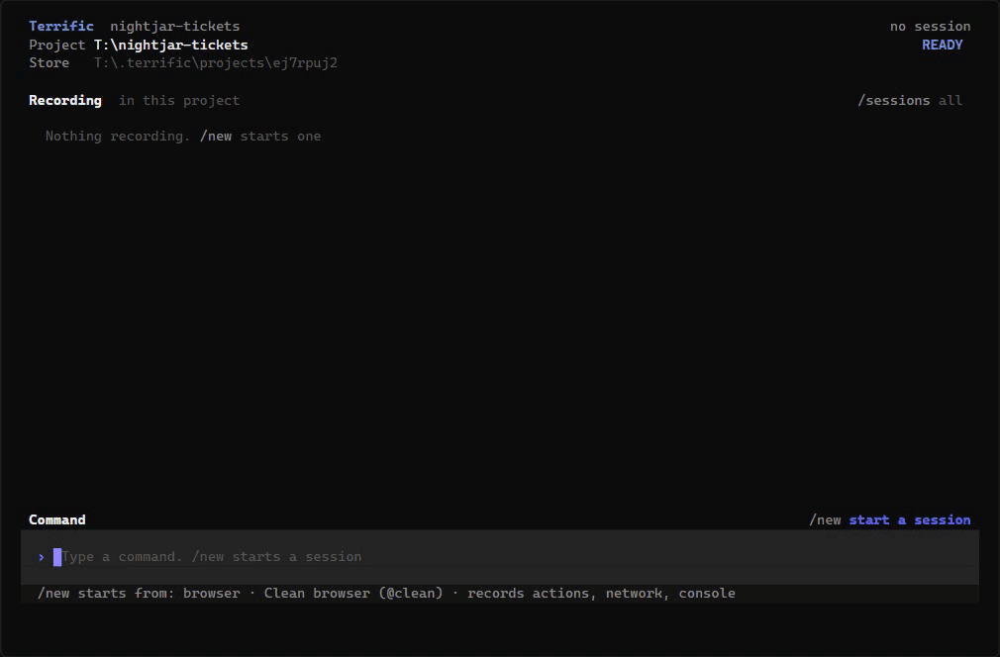
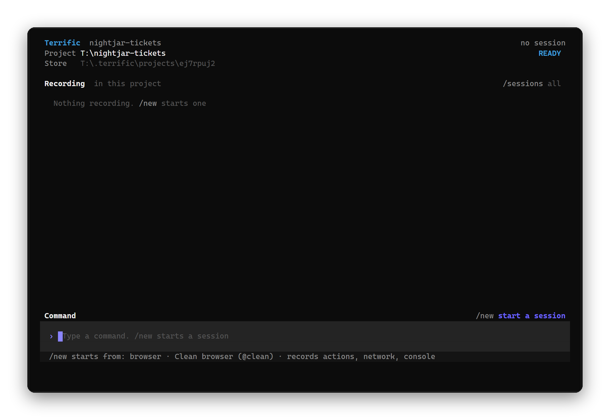
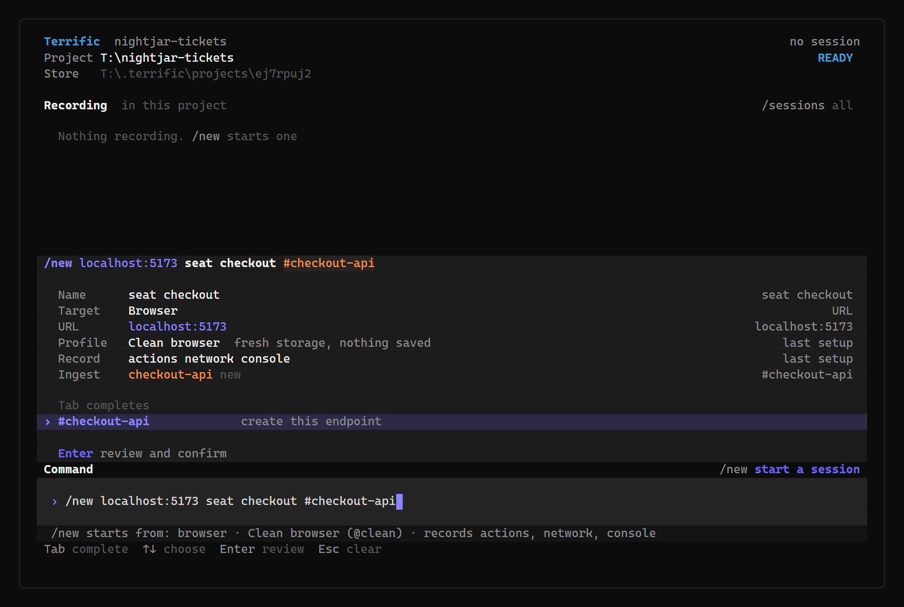
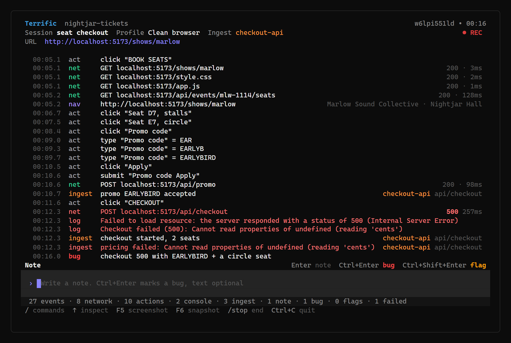
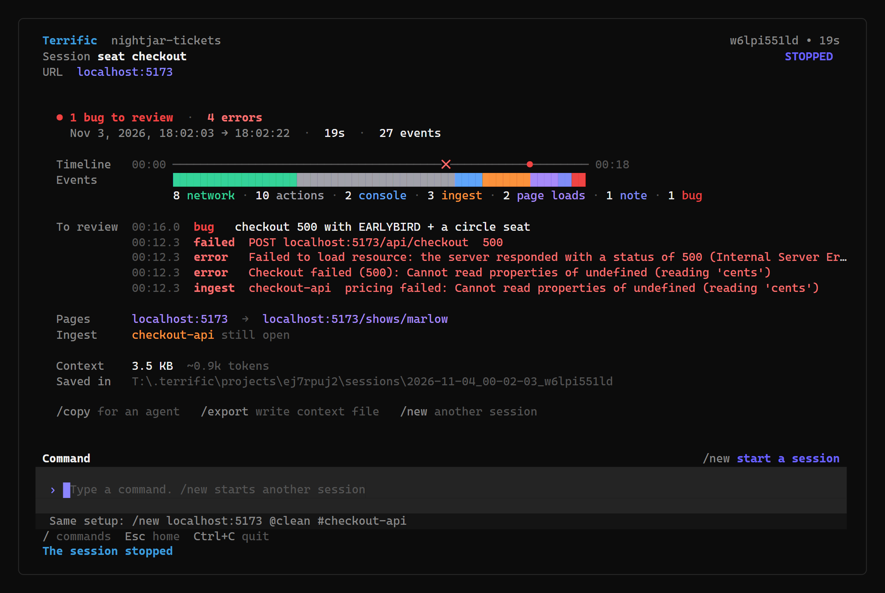
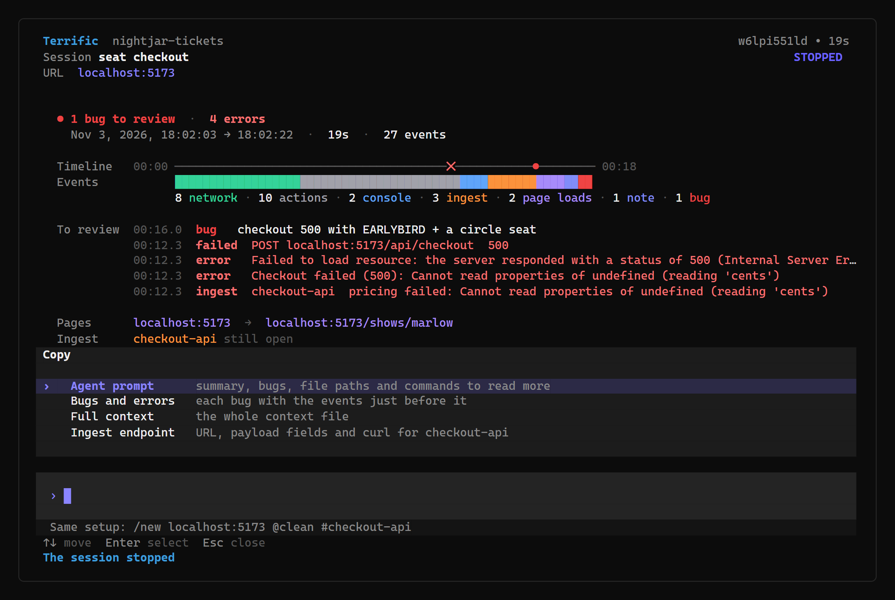
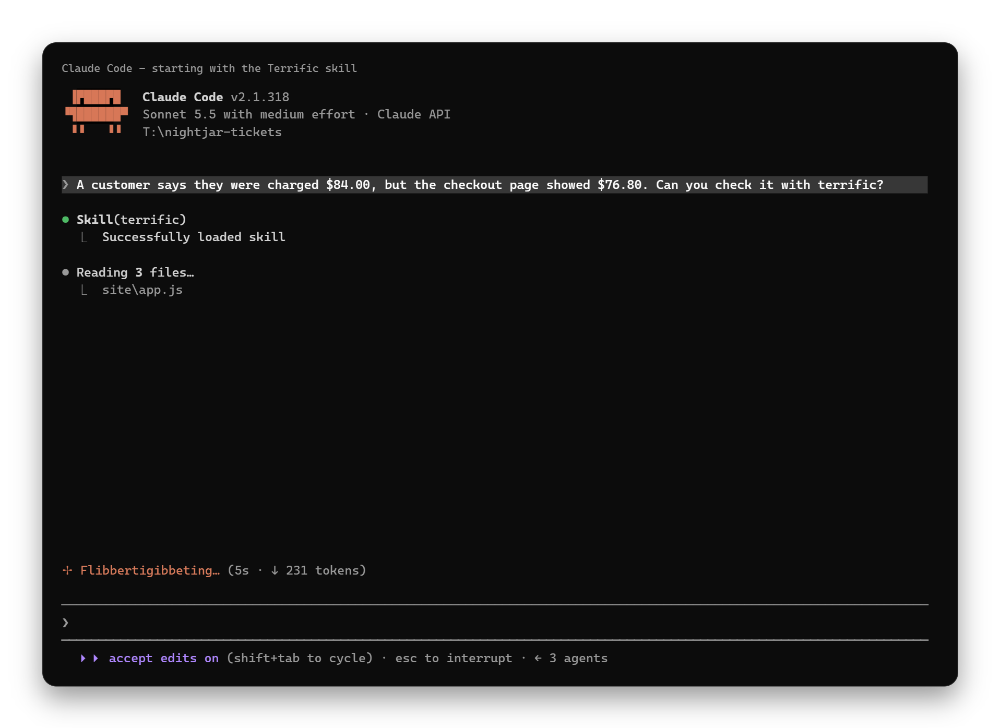
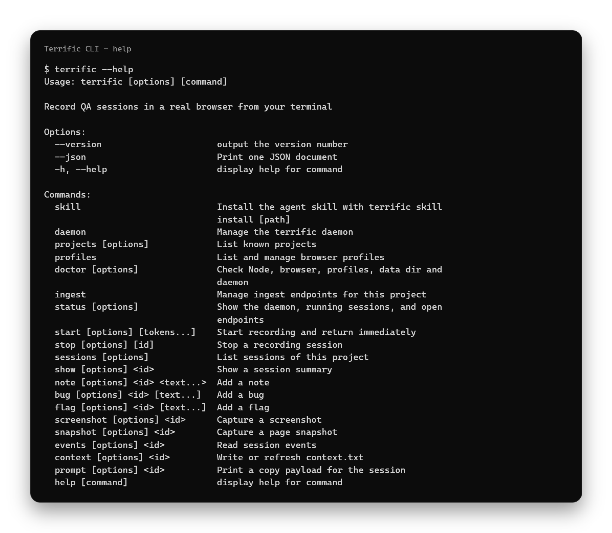

<p align="center">
  
</p>

# Terrific

Record debugging sessions from your terminal. Give coding agents the runtime evidence.

[Getting started](#getting-started) · [Agent workflow](#debugging-with-an-agent) · [Contributing](CONTRIBUTING.md) · [MIT license](LICENSE)



Terrific captures browser actions, network requests, console output, and telemetry from your code in one timeline. Reproduce a bug, mark what matters, and hand the session to a coding agent with timestamps, targeted read commands, and local evidence files.

Use the interactive terminal UI while testing, or the CLI from an agent, script, or another terminal. Sessions can also run without a browser to capture backend, worker, and command-line diagnostics.

## Showcase

### Record and review a browser session

Start a recording, reproduce a failed checkout, mark the bug, and prepare the evidence for an agent.

https://github.com/user-attachments/assets/c9e8621c-91be-44bd-8164-4e57af562411

### Investigate with Claude Code

Follow Claude Code as it investigates a checkout that shows $76.80 but charges $84.00, using Terrific to collect runtime evidence.

https://github.com/user-attachments/assets/0d3e2903-de28-4684-8304-6d065e3fd598

## Getting started

Terrific is under active development. The npm package has not been published yet; install from a local checkout.

Requires **Node.js 22.19 or later** and an installed Chromium-based browser, such as Chrome or Edge, for browser sessions.

```sh
npm ci
npm run build
npm link
```

Then open a terminal in the project you want to test:

```sh
cd /path/to/your-project
terrific
```



Run `terrific doctor` if setup fails. It checks Node.js, browser discovery, profiles, the data directory, and the daemon.

### Record your first session

1. Type `/new localhost:5173 "checkout"` in the TUI and confirm the recording setup.
2. Reproduce the issue in the browser Terrific opens. Actions, requests, and console events appear in the live log.
3. Type a note, or use `/bug` and `/flag` to mark a moment. Use `/screenshot` or `/snapshot` to capture the page.
4. Run `/stop` and confirm. The summary shows bugs, errors, failed requests, and the saved session location.
5. Run `/copy` to copy the agent prompt, bugs and errors, or full context.

The directory where you launch Terrific identifies the project. A shared local daemon keeps recordings running when you close the TUI.

## Inside Terrific

|                                                                                                    |                                                                                                                   |
| -------------------------------------------------------------------------------------------------- | ----------------------------------------------------------------------------------------------------------------- |
| **Compose a recording** Set the URL, session name, profile, and endpoint in one command.           | **Capture and annotate** Correlate browser actions, network failures, and app telemetry, then mark the bug.       |
|                   |  |
| **Review the evidence** See the timeline, event counts, bugs, errors, and saved session location.  | **Hand off to an agent** Choose an agent prompt, bugs and errors, full context, or endpoint details.              |
|  |                             |

Select any screenshot to open it at full size.

## What a session captures

| Evidence | Contents |
| --- | --- |
| Browser actions | Clicks, input changes, selections, and navigation |
| Network | Requests, responses, failures, timing, and captured bodies |
| Console | Browser logs, warnings, and errors |
| Page captures | Screenshots and page snapshots as Markdown |
| Annotations | Notes, bugs, and flags placed on the timeline |
| App telemetry | Diagnostic events posted by your own instrumented code |

The demo uses a fictional ticket checkout. Both the browser session and the Claude Code investigation were recorded against a running application.

## Debugging with an agent

Terrific includes a skill that teaches coding agents to instrument a suspected code path, collect evidence, investigate the recording, and verify a fix in a new session.



Install it from your application's project directory:

```sh
terrific skill install
```

The default destination is `.agents/skills/terrific`. For clients that use another skill directory, pass the full destination:

```sh
terrific skill install ~/.claude/skills/terrific
```

Installation refuses to overwrite an existing directory. See the bundled [agent skill](.agents/skills/terrific/SKILL.md) for the full workflow and telemetry examples.

### Bring application logs into the timeline

Create a named ingest endpoint for the feature you are debugging:

```sh
terrific ingest up checkout
```

The command prints a local POST URL. Send diagnostic events to that URL from your code, then link a recording to the endpoint:

```sh
terrific start localhost:5173 "checkout total" "#checkout"
```

Endpoint tokens begin with `#`; quote them in shell commands. An endpoint keeps the same URL when reopened, stores telemetry even without a recording, and stays open when a session stops. It closes after 24 hours without events.

For a backend, script, or worker, start without a browser:

```sh
terrific start "payment webhook" "#checkout" --no-browser
```

### Read the evidence

Use the session ID printed by `start` or listed by `terrific sessions` in place of `SESSION_ID`:

```sh
terrific stop SESSION_ID
terrific prompt SESSION_ID
terrific events SESSION_ID --type errors
terrific events SESSION_ID --type ingest
terrific events SESSION_ID --around 01:20 --window 10s
```

`prompt` returns a summary, annotations, file paths, and commands for focused reads. `events --follow` streams a running session. `context` writes an agent context export; filters change the export while the underlying event log is retained.

## CLI reference

Run `terrific --help` or `terrific <command> --help` for all options.



| Command | Purpose |
| --- | --- |
| `terrific` | Open the interactive terminal UI |
| `terrific start [tokens...]` | Start recording and return immediately |
| `terrific stop [id]` | Stop a recording and save its context |
| `terrific status` | Show running sessions and open endpoints |
| `terrific sessions` | List this project's sessions |
| `terrific show <id>` | Inspect session details |
| `terrific note <id> <text>` | Add a note |
| `terrific bug <id> [text]` | Mark a bug |
| `terrific flag <id> [text]` | Flag a moment for review |
| `terrific screenshot <id>` | Capture the browser page as an image |
| `terrific snapshot <id>` | Capture the browser page as Markdown |
| `terrific events <id>` | Read or follow recorded events |
| `terrific context <id>` | Write the session's context export |
| `terrific prompt <id>` | Generate an agent handoff |
| `terrific ingest` | Manage project telemetry endpoints |
| `terrific profiles` | Manage reusable browser profiles |
| `terrific doctor` | Diagnose local setup problems |

Use `--json` on commands that support structured output. `events --follow --json` emits one JSON event per line.

## Local storage and configuration

Recordings are stored under `~/Documents/.terrific` on Windows and `~/.terrific` elsewhere. Each project has its own sessions and ingest endpoints. Session folders contain `session.json`, the append-only `events.jsonl`, `context.txt`, and any screenshots.

| Variable | Purpose |
| --- | --- |
| `TERRIFIC_HOME` | Override the data directory |
| `TERRIFIC_PORT` | Override the daemon port, default `4569` |
| `TERRIFIC_HEADLESS=1` | Launch recording browsers without a window for automation |

The daemon binds to `127.0.0.1`. Its API uses a local token; ingest URLs carry their own endpoint token. Treat recordings, endpoint URLs, and saved browser profiles as sensitive: network bodies, app telemetry, and page captures can contain application data. Review evidence before sharing it.

## Development

```sh
npm ci
npm run dev -- --help
npm run check
```

`npm run check` runs lint, type checking, tests, the build, distribution smoke checks, and package validation.

Read [CONTRIBUTING.md](CONTRIBUTING.md) for contribution guidelines and [SECURITY.md](SECURITY.md) for reporting vulnerabilities. Implementation notes live in [docs/design.md](docs/design.md); changes are tracked in [CHANGELOG.md](CHANGELOG.md).

## License

[MIT](LICENSE) © Rodrigo Garciaguirre.

---

By [Rodrigo Garciaguirre](https://rod.run) · [Portfolio](https://rod.run) · [haiku.ac](https://haiku.ac)
